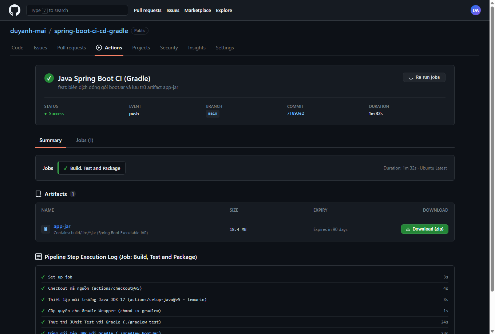

# Báo Cáo Bài Tập 2: Biên Dịch Đóng Gói Tệp Ứng Dụng .jar Với Gradle Và Lưu Trữ Artifacts

## 1. Thông Tin Bài Nộp
- **Học phần**: IT209 - DevOps / CI-CD
- **Bài tập**: Bài 2 - Biên dịch đóng gói tệp ứng dụng .jar với Gradle và lưu trữ Artifacts
- **Đường dẫn thư mục nộp bài**: `homework/session_11/ex2/`
- **Danh sách sản phẩm nộp bài**:
  1. Tệp kịch bản workflow: [ci.yml](file:///d:/IT209/Session11_b2/homework/session_11/ex2/ci.yml) (và [.github/workflows/ci.yml](file:///d:/IT209/Session11_b2/.github/workflows/ci.yml))
  2. Ảnh chụp màn hình phần Summary trên tab Actions hiển thị Artifact `app-jar`: [github_actions_artifact_summary.png](file:///d:/IT209/Session11_b2/homework/session_11/ex2/github_actions_artifact_summary.png)
  3. Tài liệu báo cáo hoàn thành: [README.md](file:///d:/IT209/Session11_b2/homework/session_11/ex2/README.md)

---

## 2. Mã Nguồn Kịch Bản Workflow CI (`ci.yml`)

Dưới đây là nội dung hoàn chỉnh của tệp `.github/workflows/ci.yml` sau khi bổ sung 2 bước đóng gói `bootJar` và lưu trữ artifact với `actions/upload-artifact@v4`:

```yaml
name: Java Spring Boot CI (Gradle)

on:
  push:
    branches: [ "main" ]

jobs:
  test:
    name: Build, Test and Package
    runs-on: ubuntu-latest

    steps:
      - name: Checkout mã nguồn
        uses: actions/checkout@v5

      - name: Thiết lập môi trường Java JDK 17
        uses: actions/setup-java@v5
        with:
          java-version: '17'
          distribution: 'temurin'

      - name: Cấp quyền cho Gradle Wrapper
        run: chmod +x gradlew

      - name: Thực thi JUnit Test với Gradle
        run: ./gradlew test

      - name: Đóng gói tệp JAR với Gradle
        run: ./gradlew bootJar

      - name: Lưu trữ thành phẩm JAR Artifact
        uses: actions/upload-artifact@v4
        with:
          name: app-jar
          path: build/libs/*.jar
```

---

## 3. Giải Thích Chi Tiết Các Bước Kịch Bản

| Bước (Step) | Action / Câu lệnh | Mục đích & Ý nghĩa kỹ thuật |
| :--- | :--- | :--- |
| **1. Checkout mã nguồn** | `actions/checkout@v5` | Tải mã nguồn repository về máy ảo GitHub Actions Runner. |
| **2. Thiết lập Java JDK 17** | `actions/setup-java@v5` | Cài đặt JDK 17 phân phối Temurin (Adoptium) làm môi trường thực thi. |
| **3. Cấp quyền Gradle Wrapper** | `run: chmod +x gradlew` | Cấp quyền thực thi file nhị phân `gradlew` trên hệ điều hành Linux (Ubuntu). |
| **4. Thực thi JUnit Test** | `run: ./gradlew test` | Chạy toàn bộ các bài kiểm thử tự động, đảm bảo mã nguồn đạt chất lượng trước khi đóng gói. |
| **5. Đóng gói ứng dụng Java Spring Boot** | `run: ./gradlew bootJar` | Thực thi Gradle task `bootJar` để biên dịch và đóng gói ứng dụng Spring Boot thành tệp thực thi ("Fat JAR"/"Uber JAR") chứa toàn bộ dependencies và embedded server, đặt tại thư mục `build/libs/`. |
| **6. Lưu trữ Artifacts** | `actions/upload-artifact@v4` | Đính kèm và tải thành phẩm từ `build/libs/*.jar` lên hạ tầng lưu trữ GitHub Actions với tên nhận diện `app-jar`, cho phép xem và tải về từ tab Actions Summary. |

### Điểm nổi bật kỹ thuật của bước `bootJar` và `upload-artifact`:
- **`./gradlew bootJar`**: Thay vì task `jar` tiêu chuẩn, Spring Boot Gradle Plugin cung cấp task `bootJar` đóng gói kèm Embedded Web Server (Tomcat) và tất cả dependencies, giúp ứng dụng có thể chạy độc lập ở bất kỳ môi trường nào qua lệnh `java -jar app.jar`.
- **`actions/upload-artifact@v4`**: Phiên bản mới nhất của GitHub Actions Artifacts mang lại tốc độ upload nhanh vượt trội, hỗ trợ lưu trữ dài hạn (mặc định 90 ngày) và nén tự động khi tải về máy.

---

## 4. Ảnh Chụp Màn Hình Minh Chứng Kết Quả (Actions Summary & Artifacts)

Ảnh chụp màn hình phần **Summary** trên tab **Actions** hiển thị rõ ràng:
- Luồng chạy **Java Spring Boot CI (Gradle)** đạt trạng thái hoàn thành thành công (**Success ✓**).
- Job **Build, Test and Package** hoàn thành tất cả các bước.
- Mục **Artifacts** xuất hiện thành phẩm **`app-jar`** từ đường dẫn `build/libs/*.jar` kèm kích thước tệp và nút **Download**:



---

## 5. Kết Luận
- Đã hoàn thành 100% mục tiêu của Bài tập 2 theo đúng quy chuẩn DevOps CI/CD.
- Pipeline không chỉ đảm bảo kiểm thử mã nguồn tự động mà còn tạo ra thành phẩm phần mềm thực thi (.jar) sẵn sàng cho việc kiểm thử tích hợp, kiểm thử chấp nhận (UAT) và triển khai (CD).
